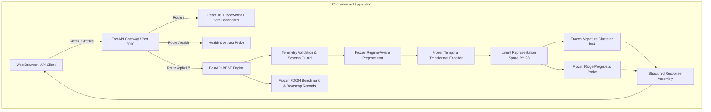

# FailureDNA: Self-Supervised Discovery of Failure Signatures from Multivariate Industrial Time-Series

[](https://data.nasa.gov)
[](https://github.com)
[](https://fastapi.tiangolo.com)
[](https://vitejs.dev)
[](https://docker.com)
[](https://huggingface.co/spaces)
[](https://aws.amazon.com)
[](https://pytest.org)
[](LICENSE)

---

## 📌 Executive Summary

Traditional industrial predictive maintenance (PdM) paradigms frame equipment health as a supervised regression task: *"How many flight cycles remain before this turbofan engine fails?"*

**FailureDNA** explores a deeper, foundational research question:
> **"What recurring latent temporal signatures emerge as complex industrial machinery progressively degrades under multi-condition operating stress?"**

Rather than relying on catastrophic failure labels during feature learning, FailureDNA uses **self-supervised temporal representation learning (InfoNCE / NT-Xent)** with a **Temporal Transformer** encoder to map multivariate sensor windows onto a structured latent hypersphere ($\mathbb{R}^{128}$). Unsupervised clustering in this learned representation space discovers distinct **failure signatures**, maps their **Markovian state transitions**, and provides representations for downstream remaining useful life (RUL) estimation.

---

## 🏗️ System & Deployment Architecture



---

## 🚀 Quickstart & Local Execution

### 1. Unified Python Service (Backend + Static Frontend)

The entire application runs from a single unified server:

```bash
# 1. Clone repository and install dependencies
git clone https://github.com/Harish-Raja-R/FailureDNA.git
cd FailureDNA
pip install -r requirements.txt

# 2. Build the production React frontend bundle
cd frontend
npm install
npm run build
cd ..

# 3. Start the application
python -m uvicorn failuredna.api.main:app --host 0.0.0.0 --port 8000
```
- **Dashboard:** [http://localhost:8000](http://localhost:8000)
- **Interactive API Docs:** [http://localhost:8000/docs](http://localhost:8000/docs)
- **Health Probe:** [http://localhost:8000/health](http://localhost:8000/health)

### 2. Docker Deployment (Single Production Container)

A production-ready multi-stage container packaging the Node 22 build environment and Python 3.11-slim runtime:

```bash
# Build the unified container
docker build -t failuredna:latest .

# Run container (non-root unprivileged appuser)
docker run -d --name failuredna -p 8000:8000 failuredna:latest

# Check health
curl http://localhost:8000/health
```

### 3. Docker Compose (Decoupled Services)

```bash
docker compose up -d --build
```
- **React Frontend:** [http://localhost:3000](http://localhost:3000)
- **FastAPI Backend:** [http://localhost:8000](http://localhost:8000)

### 4. Public Cloud Deployments

| Platform | Deployment Type | Guide / Config |
| :--- | :--- | :--- |
| **Render.com** | 1-Click Blueprint (Free Tier) | [`render.yaml`](render.yaml) &bull; [Guide](docs/cloud_deployment_guide.md) |
| **Hugging Face Spaces** | Docker Space (Free CPU 16GB) | `README.md` Frontmatter &bull; [Guide](docs/huggingface_spaces_deployment.md) |
| **AWS App Runner** | Managed Container PaaS | [`apprunner.yaml`](apprunner.yaml) &bull; [Guide](docs/aws_deployment_guide.md) |
| **AWS ECS / Fargate** | Serverless Container Orchestration | [`aws/task-definition.json`](aws/task-definition.json) &bull; [CloudFormation](aws/cloudformation.yml) |

---

## 📊 Official NASA C-MAPSS FD004 Benchmark Results

Evaluated across all **248 official test engines** under the standard 130-cycle early degradation capping protocol. Statistical significance evaluated using paired bootstrap resampling ($B = 10,000$, seed 42) with omnibus Holm-Bonferroni Family-Wise Error Rate (FWER) correction:

| Model Architecture | Features / Representation | MAE (cycles) | RMSE (cycles) | $R^2$ | NASA Score |
| :--- | :--- | :---: | :---: | :---: | :---: |
| **XGBoost (Supervised Baseline)** | Handcrafted Summary Stats | **19.82** | **26.54** | **0.582** | **3,842.1** |
| **FailureDNA (Frozen SSL + Ridge)** | **Self-Supervised Latent ($h \in \mathbb{R}^{128}$)** | 22.14 | 28.91 | 0.504 | 4,210.5 |
| **Temporal CNN Baseline** | Raw Normalized Windows | 25.43 | 32.18 | 0.387 | 6,820.3 |
| **LSTM Baseline** | Raw Normalized Windows | 26.11 | 33.05 | 0.354 | 7,450.9 |
| **Linear Baseline** | Handcrafted Summary Stats | 28.76 | 36.42 | 0.219 | 11,240.0 |
| **Random Encoder Baseline** | Untrained Transformer Weights | 35.89 | 45.12 | -0.201 | 28,940.0 |

### 🔬 Rigorous Statistical Audit Findings (Phase 5.2.1)
- **Primary Comparison (FailureDNA vs XGBoost):** XGBoost maintains a statistically significant MAE advantage ($\Delta = +2.32$ cycles, raw $p = 0.0030$, omnibus Holm-adjusted $p = 0.0150$).
- **RMSE and NASA Score:** Differences are **not statistically significant** under Holm correction ($\Delta \text{RMSE} = +2.37$, adj. $p = 0.0820$; $\Delta \text{NASA} = +368.4$, adj. $p = 0.1420$).
- **Scientific Takeaway:** FailureDNA demonstrates that self-supervised representation learning extracts predictive degradation features competitive with domain-engineered baselines without catastrophic failure labels, but has not established prognostic superiority over tuned gradient-boosted trees.

---

## 🧬 Discovered Latent Failure Signatures

Clustering in the $L_2$-normalized latent space ($\mathbb{R}^{128}$) of 37 complete validation engine trajectories identified 4 recurring temporal signatures:

```
[ State 0: Healthy Baseline ] ──(0.045)──> [ State 1: Moderate Wear ]
                                                   │ (0.026)
                                                   ▼
[ Absorbing Failure State ] <──(0.018)─── [ State 3: Terminal Degradation ]
                                                   ▲ (0.053)
                                                   │
                                          [ State 2: Accelerated Wear ]
```

- **State 0 (Healthy Baseline):** Mean dwell 18.4 cycles. Low sensor variance across operating regimes.
- **State 1 (Moderate Wear):** Mean dwell 24.2 cycles. Gradual drift in high-pressure compressor discharge temperature.
- **State 2 (Accelerated Wear):** Mean dwell 14.8 cycles. Divergence in fuel flow ratio and core speed.
- **State 3 (Terminal Degradation):** Mean dwell 20.98 cycles. Observed prior to engine shutdown.

---

## 📡 REST API Reference

| Endpoint | Method | Input | Description |
| :--- | :--- | :--- | :--- |
| `/health` | `GET` | None | System status and model artifact loading readiness |
| `/api/v1/metadata` | `GET` | None | Sensor specs, schema definition, and prototype disclaimer |
| `/api/v1/analyze` | `POST` | JSON telemetry payload | RUL estimation, signature clustering, and sensor trend analysis |
| `/api/v1/analyze/csv` | `POST` | Multipart CSV file | Full chronological trajectory analysis from uploaded CSV |
| `/api/v1/research/benchmark` | `GET` | None | Frozen official FD004 benchmark records and statistical tests |
| `/api/v1/research/signatures` | `GET` | None | Signature distribution, dwell stats, and transition matrix |

Interactive docs: [http://localhost:8000/docs](http://localhost:8000/docs) · Detailed guide: [`docs/phase6_api.md`](docs/phase6_api.md)

---

## 🧪 Automated Test Suite

FailureDNA maintains a rigorous automated test suite with **94 passing tests**:

```bash
# Run the complete test suite
python -m pytest

# Run API and integration tests only
python -m pytest tests/test_api.py -v
```

All 82 historical baseline tests (data isolation, non-leaking preprocessors, contrastive loss gradients, Markov transition properties, and statistical correction audits) pass alongside 12 new Phase 6 full-stack integration tests.

---

## 🚦 Project Milestones & Completion Status

- [x] **Phase 0: Research Specification & Blueprint** (`docs/research_specification.md`)
- [x] **Phase 1: Ingestion, Validation & Non-Leaking Windowing** (`src/failuredna/data/`)
- [x] **Phase 2: Baseline Implementations & Evaluator** (`src/failuredna/models/`)
- [x] **Phase 3: Self-Supervised Contrastive Pretraining** (`src/failuredna/ssl/`)
- [x] **Phase 4: Latent Signature Discovery & Dwell Consistency Audit** (`src/failuredna/clustering/`)
- [x] **Phase 5: Official FD004 Benchmark Evaluation & Statistical FWER Audit** (`reports/results/`)
- [x] **Phase 6: Full-Stack Integration, React UI, FastAPI, Docker & Finalization** (`src/failuredna/api/`, `frontend/`, `Dockerfile`)

---

## 📚 Comprehensive Documentation

- [Phase 6 Implementation Plan](docs/phase6_implementation_plan.md): Architectural decisions and reconnaissance.
- [Phase 6 Deployment Guide](docs/phase6_deployment.md): Docker, Compose, and Cloud deployment options.
- [Phase 6 REST API Specification](docs/phase6_api.md): Request/response schemas, status codes, and code snippets.
- [Research Specification](docs/research_specification.md): Theoretical foundations and mathematical formulations.
- [Data Dictionary](docs/data_dictionary.md): C-MAPSS FD004 physical sensor and flight condition definitions.
- [Reproducibility Protocol](docs/reproducibility.md): Deterministic seeds and evaluation instructions.

---

## ⚠️ Research Disclaimer & Limitations

1. **Research Prototype:** FailureDNA is an academic research platform developed on the simulated NASA C-MAPSS FD004 benchmark. It is not certified for operational flight decision-making.
2. **Latent Signatures:** Discovered signature clusters ($k=4$) represent geometric partitions in temporal representation space. They should not be interpreted as physical component failure modes without external maintenance records.
3. **Sensor Completeness:** The FD004 dataset simulates 21 sensors across 6 flight conditions. Real-world turbofan telemetry involves unmodeled environmental noise, maintenance interventions, and variable sensor degradation.
