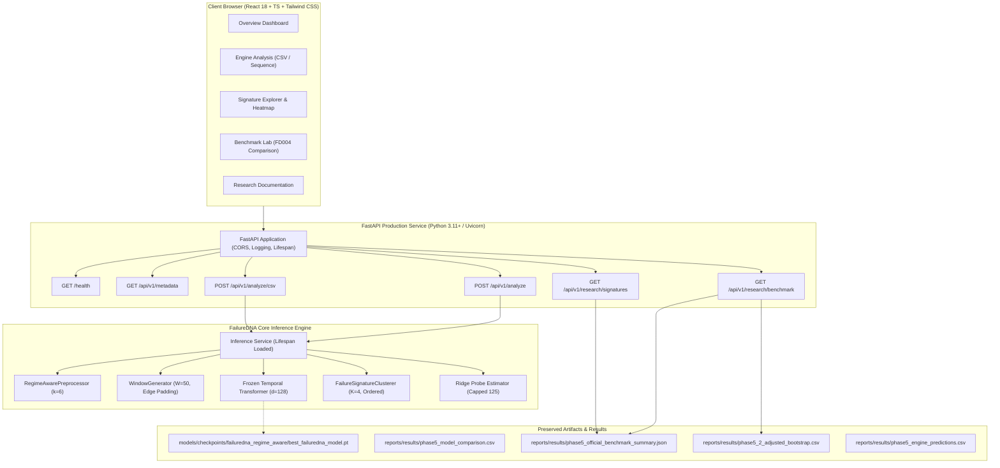

# FailureDNA — Phase 6: Implementation Plan & Full-Stack Deployment Strategy

**Project:** FailureDNA: Self-Supervised Discovery of Failure Signatures from Multivariate Industrial Time-Series  
**Dataset:** NASA C-MAPSS FD004 (249 train engines, 248 official test engines, 6 operational flight conditions, 2 degradation modes)  
**Phase:** Phase 6 (Full-Stack Integration, Deployment & Finalization)  
**Status:** In Progress — Step 1 (Repository Reconnaissance Complete)

---

## 1. Discovered Architecture and Artifact Manifest

### 1.1 Existing Frozen Checkpoints
Cryptographic hashes and architectures verified against the Phase 5 / 5.1 audit manifest:

| Model Identifier | File Path | SHA-256 Hash | Size (Bytes) | Parameters / Dimensions |
| :--- | :--- | :--- | :---: | :--- |
| `failuredna_regime_aware` | `models/checkpoints/failuredna_regime_aware/best_failuredna_model.pt` | `d18b6cd0abc2fadf12be18f6f1962707f3626e0a5054970147f50eb3620eb248` | 2,369,441 | 4-Layer, 8-Head Temporal Transformer ($d_{\text{model}}=128$, input dim: 24, pooling: masked mean) |
| `failuredna_pooled` | `models/checkpoints/failuredna_pooled/best_failuredna_model.pt` | `1e93ab9cbf31185838020c03c557b593f018b2b4aa2420d5b8c2732d288878ef` | 2,369,441 | Ablation (RobustScaler pooled normalization, 24 dims) |
| `failuredna_regime_conditioned` | `models/checkpoints/failuredna_regime_conditioned/best_failuredna_model.pt` | `67b379d2d31a1cabe99cf5809cd5bcf7d606f3224ea9566da716f9c75c851fbb` | 2,372,513 | Ablation (30 dims: 24 normalized channels + 6 one-hot regimes) |
| `failuredna_w30` | `models/checkpoints/failuredna_w30/best_failuredna_model.pt` | `8aa450d5612542b0827d7f9d6b1d295ab7e06014175e1f7f0c779c68d431b791` | 2,369,441 | Ablation (Window length $W=30$, 24 dims) |

### 1.2 Preprocessing, Signature Discovery, and Downstream Estimation
- **Raw Telemetry Format**: 26 space-delimited columns:
  - `unit_id` (1 to N)
  - `time_cycles` (1 to T)
  - `setting_1`, `setting_2`, `setting_3` (operating altitude, Mach, throttle resolver angle)
  - `s_1` through `s_21` (21 turbofan sensor channels)
- **Preprocessors**:
  - `RegimeAwarePreprocessor(n_regimes=6, include_settings=True, include_regime_onehot=False, seed=42)` fitted strictly on training partition (174 engines, `seed=42`).
  - Identifies 6 flight operating regimes via KMeans on setting variables.
  - Standardizes sensor channels within each operating regime. 5 non-varying sensor channels (`s_1`, `s_5`, `s_10`, `s_16`, `s_19`) within regimes are guarded against division by zero.
  - Outputs 24 standardized channels (3 settings + 21 sensor channels).
- **Sequence Windowing**:
  - Sequence length $W=50$ cycles, stride $s=1$.
  - Short engine trajectories ($T < 50$ cycles) are edge-padded at cycle 0 with valid boolean mask propagation.
- **Latent Representation Extraction**:
  - Frozen Temporal Transformer Encoder maps window $(B, 50, 24) \to (B, 128)$ latent representation.
- **Signature Discovery**:
  - `FailureSignatureClusterer(n_clusters=4, method="kmeans", random_state=42)` fitted on training embeddings.
  - Cluster indices ordered monotonically by training lifecycle progression ($0 \to 3$):
    - **State 0**: Baseline Healthy / Nominal operation ($36.3\%$ fleet occupancy)
    - **State 1**: Early degradation signature ($36.3\%$ fleet occupancy)
    - **State 2**: Accelerated degradation signature ($7.8\%$ fleet occupancy)
    - **State 3**: Critical terminal wear signature ($6.8\%$ fleet occupancy)
- **Downstream RUL Estimator**:
  - `make_pipeline(StandardScaler(), Ridge(alpha=10.0))` fitted on training embeddings and targets ($y \in [0, 125]$).
  - Reproduces official test predictions in `phase5_engine_predictions.csv` with **$0.00000000$ maximum absolute difference**.

---

## 2. Full-Stack System Architecture



---

## 3. API Contract Specification

### 3.1 Health & Metadata
- **`GET /health`**
  - Response: `{ status: "healthy" | "degraded", version: "1.0.0", timestamp: string, artifacts: { model_loaded: bool, preprocessor_loaded: bool, clusterer_loaded: bool, probe_loaded: bool }, memory_usage_mb: float }`
- **`GET /api/v1/metadata`**
  - Response: Dataset provenance, sensor count (21), setting count (3), sequence window length ($W=50$), feature schema, model identifiers, SHA-256 hashes, research prototype disclaimer, and statistical summary.

### 3.2 Telemetry Analysis
- **`POST /api/v1/analyze`**
  - Request:
    ```json
    {
      "unit_id": 1,
      "sequence": [
        {
          "cycle": 1,
          "setting_1": -0.0007,
          "setting_2": -0.0004,
          "setting_3": 100.0,
          "s_1": 518.67,
          "...": "...",
          "s_21": 23.4190
        }
      ]
    }
    ```
  - Validation:
    - Sequence length must be $\ge 1$ cycle. If $1 \le T < 50$, edge padding is applied to cycle 0, and a `short_sequence_warning` is issued.
    - Exactly 24 telemetry values (3 settings, 21 sensors) per cycle.
    - Finite float validation (no NaN, null, or Inf).
  - Response:
    ```json
    {
      "unit_id": 1,
      "sequence_length": 50,
      "padding_applied": false,
      "predicted_rul": 47.28,
      "rul_cap_applied": false,
      "signature_state": 3,
      "signature_name": "State 3",
      "distance_to_centroid": 1.482,
      "operating_regimes_detected": [2, 3, 5],
      "warnings": [],
      "sensor_trends": {
        "s_2": { "start": 642.1, "end": 643.8, "delta": 1.7, "mean": 642.9 },
        "s_3": { "start": 1589.2, "end": 1601.5, "delta": 12.3, "mean": 1595.0 }
      },
      "model_metadata": {
        "encoder": "TemporalTransformerEncoder(4L, 8H, d=128)",
        "estimator": "Ridge(alpha=10.0)",
        "window_size": 50,
        "checkpoint_sha256": "d18b6cd0abc2fadf..."
      }
    }
    ```

- **`POST /api/v1/analyze/csv`**
  - Accepts multipart form data with `.csv` upload.
  - Maximum upload size: 10 MB.
  - Validates CSV headers against expected C-MAPSS column names (`cycle` / `time_cycles`, `setting_1`..`setting_3`, `s_1`..`s_21`, optional `unit_id`).
  - Sorts chronologically by cycle.
  - Returns structured analysis equivalent to `POST /api/v1/analyze`.

### 3.3 Research Results Endpoints
- **`GET /api/v1/research/benchmark`**
  - Returns saved model comparison table, 95% bootstrap confidence intervals, and multiple-comparisons adjustments (raw $p$, Holm per-metric, Holm omnibus).
  - Explicitly states: "FailureDNA has not established overall prognostic superiority over XGBoost. XGBoost has a statistically significant MAE advantage under the reported omnibus Holm correction ($p=0.0150$), while RMSE and NASA score differences are not statistically significant."
- **`GET /api/v1/research/signatures`**
  - Returns fleet occupancy, 4x4 state transition matrix, empirical mean dwell times, hazard audit metrics, and signature-regime NMI ($0.000143$).

---

## 4. Frontend Structure

Built in `frontend/` using Vite, React 18, TypeScript, and Tailwind CSS.
- **Theme**: Dark charcoal (`#0B0F17`), deep slate panels (`#131B2E`), subtle crimson/amber warning accents (`#EF4444`, `#F59E0B`), electric cyan telemetry highlights (`#06B6D4`), clean white/muted text (`#F8FAFC`, `#94A3B8`).
- **Pages**:
  1. **Overview**: Executive dashboard, system architecture diagram, artifact health, live API status, dataset stats.
  2. **Engine Analysis**: Interactive telemetry sequence inspector, CSV drag-and-drop file uploader, real-time RUL estimation, discrete signature assignment, multi-sensor trend charts.
  3. **Signature Explorer**: 4 discovered degradation states, fleet occupancy breakdown, 4x4 state transition probability heatmap, empirical vs model-based dwell times, hazard-rate audit notes.
  4. **Benchmark Lab**: Official FD004 248-engine test results, interactive MAE / RMSE / R² / NASA score charts, model comparison table, Holm-adjusted paired bootstrap p-values, explicit scientific limitations.
  5. **Documentation**: Full-stack system documentation, REST API interactive schemas, data dictionary, mathematical formulas, and research disclaimer.

---

## 5. Deployment and Packaging Strategy

- **Backend Container (`Dockerfile.backend`)**:
  - Python 3.11-slim base image.
  - Install dependencies from `requirements.txt`.
  - Non-root user `appuser`.
  - Healthcheck via curl to `http://localhost:8000/health`.
- **Frontend Container (`Dockerfile.frontend`)**:
  - Multi-stage build (Node 22-alpine build stage $\to$ Nginx alpine production image).
  - Production static bundle served via Nginx reverse proxy routing `/api` requests to backend.
- **Unified Local Container (`Dockerfile`)**:
  - Optional single-container packaging serving built static frontend assets directly through FastAPI `StaticFiles`, ideal for zero-configuration local runs and simple cloud deployments (Render, Hugging Face Spaces, Railway, AWS App Runner).
- **Docker Compose (`docker-compose.yml`)**:
  - Orchestrates backend (port 8000) and frontend (port 3000) with volume mounts, environment variables, and health dependency.

---

## 6. Verification and Acceptance Criteria
1. All 82 existing unit and scientific tests pass without modification.
2. New API unit and integration tests added under `tests/test_api.py`.
3. Validated that inference outputs reproduce `phase5_engine_predictions.csv` with zero discrepancy.
4. Production frontend builds without TypeScript or Vite compilation errors.
5. Docker builds and runs cleanly with verified healthy endpoints.
6. Absolute compliance with scientific integrity: no retraining, no exaggerated claims, full preservation of existing research artifacts.
